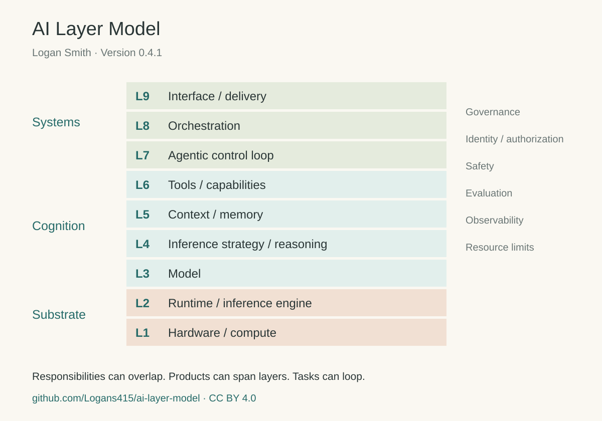

# AI Layer Model

The AI Layer Model provides a shared vocabulary for understanding how the pieces of an AI system fit together. It organizes nine runtime responsibilities into three planes, helping practitioners place unfamiliar tools, discuss system design, and identify security controls and ownership.

**Author and maintainer:** Logan Smith · **Model version:** 0.4.1

[Model reference](docs/model.md) · [Mapping skill](skills/map-ai-stack/SKILL.md) · [Authorship and citation](PROVENANCE.md) · [Contributing](CONTRIBUTING.md)

## Why a shared map matters

Asking “What are you using for inference?” might produce the answer “Qwen” or “Ollama.” Those answers describe different responsibilities: the selected model and the runtime that loads and serves it. Similar ambiguity appears when discussing agents, orchestration, memory and tools.

The model helps locate the responsibility behind an answer. That makes it easier to compare components, understand dependencies, and bring the right expertise to a security question.

## Model overview

| Plane | Layers | Responsibilities |
| --- | --- | --- |
| **Substrate** | L1–L2 | Hardware and model execution |
| **Cognition** | L3–L6 | Model, inference strategy, context and tools |
| **Systems** | L7–L9 | Control, orchestration and delivery |

Governance, identity and authorization, safety, evaluation, observability, and resource limits span the stack. Products can occupy several layers, and a task can revisit components across multiple model calls. The layers describe responsibilities rather than a fixed execution sequence.

See the [model reference](docs/model.md) for definitions, boundaries and the companion view of model development and training. The approach is inspired by OSI's use of a shared layered vocabulary; [related work](docs/related-work.md) places it alongside other architecture and threat-modeling approaches.

## Explore the initial release

This release introduces the reference model and a practical way to apply it:

- [Layer definitions and boundaries](docs/model.md), with an original diagram and [structured reference data](model/layers.json).
- Worked examples for [Ollama](examples/ollama.md), [MCP](examples/mcp.md), and a [hypothetical meeting assistant](examples/meeting-assistant.md).
- A [portable agent skill](skills/map-ai-stack/SKILL.md) and [plain-chat prompt](prompts/map-an-item.md) for mapping another item.

### Map an item

Copy the complete `skills/map-ai-stack/` directory into the skills directory supported by your agent, retaining its reference files and license notices. If your application does not load skills, attach `SKILL.md` and `references/layers.json` to a conversation and ask the model to follow them.

Provide the item's official URL or a description, its version or deployment where relevant, and the role you want to understand. For example:

> Use the AI Layer Model to map this tool: [official project URL]. Identify its primary responsibility, any additional layers it spans, its dependencies, and the evidence for the placement.

The skill distinguishes confirmed placements from conditional ones and separates an item's responsibilities from its dependencies. It requests clarification when the available evidence is insufficient. No API key or executable service is required by the skill itself.

## Feedback and contributions

The model is open to discussion and refinement. Contributions are most useful when they identify a specific component, responsibility or boundary, include supporting evidence, and state the model version used. See [CONTRIBUTING.md](CONTRIBUTING.md) for guidance.

## Citation and licensing

Cite **Logan Smith, AI Layer Model, version 0.4.1**, with a link to this repository or the release used. [CITATION.cff](CITATION.cff) provides citation metadata; [PROVENANCE.md](PROVENANCE.md) records authorship, development and versioning.

- **CC BY 4.0:** model documentation, original diagrams, examples and layer reference data.
- **MIT:** mapping skill instructions, prompts and implementation code. The skill's bundled layer reference retains its CC BY 4.0 license.

See [LICENSE](LICENSE) for the complete file scopes and license texts. This is an independent project by Logan Smith; it does not represent an employer, vendor or standards organization.

## Validate a contribution

Run `python scripts/validate_release.py` with Python 3.12, without optimization (`-O`). The validator uses the standard library to check model consistency and release contents. The CI workflow also defines Ruff lint/format checks and Bandit static analysis.

### Build release archives

Run `python scripts/package_release.py --output ../ai-layer-model-release` with an output directory outside this checkout. The packager validates the model and includes only the paths declared in `scripts/validate_release.py`. It writes the full package, standalone skill and SHA256 checksums, and refuses to replace existing output files.

ZIP entries are sorted and use uniform permissions and the fixed timestamp `1980-01-01 00:00:00`, the ZIP format's minimum date. This is a reproducible packaging convention; archive entry timestamps do not describe when the model was developed. Published versions and dates are listed in [CHANGELOG.md](CHANGELOG.md) and the GitHub releases.

Run the release-tool regression checks with `python -m unittest discover -s tests`.
